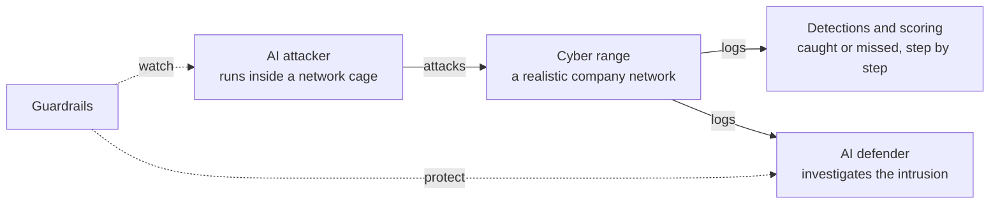

# AI Cyber Testbed

**Measuring AI on both sides of a cyber attack: as the attacker and as the defender.**

Status: research design. Some pieces are built, the first measured run has not happened yet. Last updated: 18 Nov 2026.

## The problem

AI models can now carry out multi-step attacks on realistic networks. Most evaluations score only the attacker: did it capture the flag, did it take over the host.

That leaves out half the picture. A defender wants to know something else: when an AI attacks, what do my detections see, and what do they miss?

This project builds on earlier work by others. See [Earlier research](docs/1-research-questions.md#earlier-research).

## The idea

Build one realistic, enterprise-style cyber range and measure AI on both sides of the same intrusion.

1. **Measure.** An AI attacker runs an attack inside the range. Every step is checked against standard, widely used detections: caught or missed.
2. **Defend.** Add existing guardrails (Anthropic's first) to the AI attacker and the AI defender.
3. **Measure again.** Run the same thing and compare.

## The four research questions

| # | Area | Question |
| --- | --- | --- |
| 1 | Attack (lead) | When an AI attacks, what do standard, widely used detections catch and miss, technique by technique, compared with a human attacker on the same missions? |
| 2 | Defence | Can an AI security analyst find the intrusion as well as a human analyst, scored the same way? |
| 3 | Manipulation | Can an attacker fool the AI defender by hiding instructions in the logs it reads? |
| 4 | Control | Does the AI attacker stay inside its limits, and does it behave differently in pentest mode versus APT mode? |

Question 1 is the lead. Questions 2 and 3 use the same range. Question 4 is a backup.

More detail: [Research questions](docs/1-research-questions.md).

## What makes it different

- **It measures the defender's view.** Each attack step is paired with the evidence it should leave, so the result is a caught/missed table per technique, not one pass or fail.
- **It has human baselines.** Human red teamers on the same missions, and human SOC analysts scored with numbers, not pass or fail.
- **It is not tied to one model.** Guardrail tests start with Anthropic's, but the attacker and the defender can be any model, so models can be compared on the same range.
- **It has rules for fairness.** The attacker side never sees the answers. The answers are fixed before any run. A run only counts if it passes a list of checks. See [Fair and repeatable](docs/4-fair-and-repeatable.md).

## What exists today

| Piece | Status | Evidence |
| --- | --- | --- |
| Cyber ranges with graded missions | Built | 8 training campaigns, 127 graded missions. Design published in [cyber-range-design](https://github.com/fernandodeltaflows/cyber-range-design). The SOC assessments and DFIR campaigns were built with the [Cyber Range Build System](https://github.com/fernandodeltaflows/cyber-range-design#the-cyber-range-build-system) ([guided tour](https://fernandodeltaflows.github.io/cyber-range-design/build-system-tour/)) |
| Scored analyst assessments (human baseline) | Built | Three tiers, 49 missions, 1,000 marks per tier, analysts ranked by score |
| Network cage for an AI attacker | Built, not yet public | Proven with a 10-check escape test and 53 unit tests |
| AI pentest assistant running inside the cage | Built, not yet public | PentestGPT, integrated and containment-tested against OWASP Juice Shop. A person runs every command |
| AI attacker agent with a full command log | Planned | |
| Tools to test attacks on AI agents | Built, private | Tests for prompt injection, jailbreaks, tool abuse and data leakage, built on Promptfoo, Garak and PyRIT |
| Tests against an AI analyst that reads logs | Planned | The base for question 3 |
| The research range for this testbed | Planned | Not built yet |
| First measured run (pilot) | Planned for early 2027 | Not run yet. No results exist |
| AI defender | Planned | |
| Guardrail tests | Planned | Design note first |

Nothing in this repository is a result. It describes the design and what is already built.

## Read more

1. [Research questions](docs/1-research-questions.md)
2. [How it works](docs/2-how-it-works.md)
3. [The pieces](docs/3-the-pieces.md)
4. [Fair and repeatable](docs/4-fair-and-repeatable.md)
5. [Safety](docs/5-safety.md)
6. [Roadmap](docs/6-roadmap.md)

## What is not in this repository

On purpose, this repository leaves out anything that would bias the measurements or help misuse: attack scenarios, technique lists, detection rules, answer sheets and guardrail settings. It also holds no client data.

## About

Designed by Fernando Piérola Moro ([LinkedIn](https://www.linkedin.com/in/fernandopierolamoro/)). I build cyber ranges and scored security assessments, test AI agents for security before they go live, and hold the OSCP.

The design is mine. The text in this repository was drafted with help from Claude and reviewed by me.

## Licence

The text and diagrams in this repository are licensed under [CC BY 4.0](https://creativecommons.org/licenses/by/4.0/). See [LICENSE](LICENSE).
