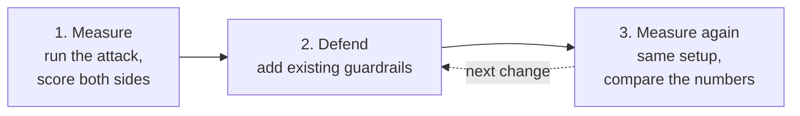

# 1. Research questions

[Back to the overview](../README.md)

The testbed asks four questions. They all use the same range, so each answer can be compared with the others.

## Question 1 (lead): what do detections catch when an AI attacks?

> When an AI attacks, what do standard, widely used detections catch and miss, technique by technique, compared with a human attacker on the same missions?

**Why it matters.** Defenders have built their detections around how human attackers work. An AI attacker may work differently: faster, noisier, or in an order a person would not choose. If so, some detections may work better against AI and some worse. Today nobody can say which, technique by technique.

**What a good answer looks like.** A table with one row per attack technique (using the public MITRE ATT&CK names). For each row: did the AI do it, did a detection fire, and how does that compare with a human red teamer on the same mission.

**Why standard detections.** The point is to learn what an ordinary, well-run company would see. So the testbed uses detections that are public and widely used, not ones tuned for this project.

## Question 2: can an AI analyst match a human analyst?

> Can an AI security analyst find the intrusion as well as a human analyst, scored the same way?

**Why it matters.** If AI attackers get better, defenders will lean on AI analysts. We need to know how good those are, on the same scale as people.

**What a good answer looks like.** An AI analyst takes the same scored assessment that human analysts take. The assessment gives a number, not pass or fail, so it can separate a good analyst from a very good one, and one model from another.

## Question 3: can the AI defender be fooled through the logs?

> Can an attacker fool the AI defender by hiding instructions in the logs it reads?

**Why it matters.** An AI analyst reads logs. Attackers control part of what goes into logs, for example names and text fields. If hidden instructions in a log can steer the analyst, the attacker can hide.

**What a good answer looks like.** How often the hidden instructions work, measured inside a full intrusion on the range, and how much the analyst's score drops.

## Question 4 (backup): does the AI attacker stay inside its limits?

> Does the AI attacker stay inside its limits, and does it behave differently in pentest mode versus APT mode?

**Why it matters.** An AI that runs attacks must stay in scope. This question checks whether it does, and whether that changes when it is asked to act like a real adversary instead of a careful tester.

**What a good answer looks like.** A count of attempts to cross the limits in each mode, on the same scenario, with the same safety cage in place. How APT mode works is kept private. See [Safety](5-safety.md).

## The cycle: measure, defend, measure again

The testbed does not invent new guardrails. It tests ones that already exist, Anthropic's first, and reports the before and after numbers.

## Human baselines

A number about AI means little without a human number next to it. The testbed plans two:

- **Attack side:** human red teamers run the same missions as the AI attacker. Planned.
- **Defence side:** human analysts already take the scored assessments. Their anonymised scores can be used for research, with permission.

## Earlier research

This project builds on work by others. It extends that work. It is not the first of its kind.

| Work | What it showed | What this testbed adds |
| --- | --- | --- |
| [Anthropic and Carnegie Mellon, Incalmo (June 2025)](https://www.anthropic.com/research/cyber-toolkits) | With a toolkit, AI models could run multi-step attacks on simulated networks of 25 to 50 hosts. The networks had no active defences, and the authors asked for more research on defended networks. | A range with detections switched on, and a record of what they see. |
| [Anthropic, update (January 2026)](https://www.anthropic.com/research/cyber-toolkits-update) | A newer model could sometimes complete such attacks with standard open-source tools only. | The same kind of attack, measured from the defender's side. |
| [Mayoral-Vilches et al., Dynamic Cyber Ranges (April 2026)](https://arxiv.org/abs/2604.24184) | AI attackers against AI defenders on ranges. Defender agents cut attacker success. | A per-technique view against standard detections, and human baselines on both sides. |
| [Balassone et al., Synthetic APTs (June 2026)](https://arxiv.org/abs/2606.07158) | AI agents acting as five known threat groups against AI defenders, in 20 experiments on two ranges. | The same per-technique view, plus a human attacker on the same missions. |
| [Pandey and Bhujang, Poisoning the Watchtower (May 2026)](https://arxiv.org/abs/2605.24421) | Hidden instructions in log fields can mislead an AI analyst assistant. Defences helped but did not close the gap. | The same attack inside a full intrusion on a realistic range, scored against human analysts, then repeated with guardrails. |

Next: [How it works](2-how-it-works.md)
