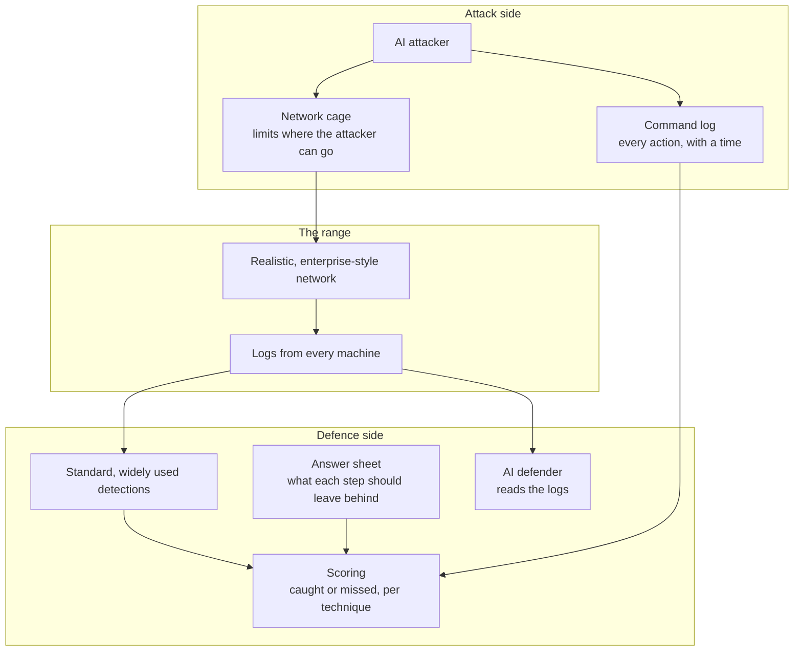
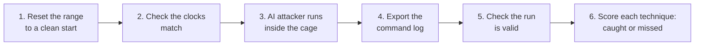

# 2. How it works

[Back to the overview](../README.md)

## The parts

- **The AI attacker** is an AI agent that is given a goal inside the range.
- **The network cage** sits between the attacker and everything else. The attacker can reach the range and nothing more.
- **The command log** records every action the attacker takes, with the time.
- **The range** is a realistic, enterprise-style network built for this research. It holds no client data.
- **The detections** are standard and widely used. They are not tuned for this project.
- **The answer sheet** says, for each attack step, what evidence it should leave and which detection should fire. It is written before any run.
- **Scoring** lines up three things: what the attacker did (the command log), what should have fired (the answer sheet) and what did fire (the detections).
- **The AI defender** reads the same logs and tries to work out what happened. It is used for questions 2 and 3.

## One run, step by step

1. The range is reset to a known clean state, so every run starts the same way.
2. The clocks on the attacker's machine and the range are compared. Scoring matches actions to alerts by time, so the clocks must agree.
3. The AI attacker runs inside the cage.
4. The command log is exported, with a unique run ID.
5. The run is checked against the rules in [Fair and repeatable](4-fair-and-repeatable.md). A run that fails is kept and marked invalid.
6. Each technique is scored: did the attacker do it, and did a detection fire.

## Two sides kept apart

The people and tools on the attack side never see the answer sheet, the detections or the scores. The defence side fixes its answers before it sees any run. This is what makes the result fair. The details are in [Fair and repeatable](4-fair-and-repeatable.md).

## Where guardrails fit

| Side | What the guardrail does | How success is measured |
| --- | --- | --- |
| AI defender | Stops hidden instructions in logs from steering the analyst | How often the hidden instructions work, before and after |
| AI attacker | A second model watches the attacker's actions and flags attempts to leave scope | Attempts caught and missed, on top of the cage |

Guardrail settings are not published here, because knowing them would bias the tests.

Next: [The pieces](3-the-pieces.md)
