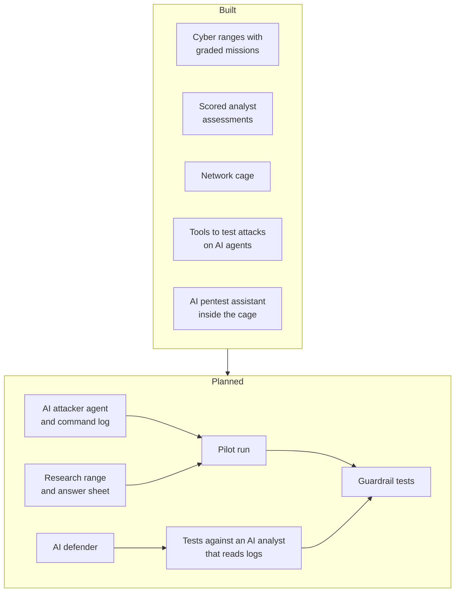

# 3. The pieces

[Back to the overview](../README.md)

This page lists each piece, what it must do, and where it stands today. "Built" means it exists and has been tested. "Planned" means it does not exist yet.

## Cyber ranges with graded missions

**Status: built.**

- **What it is.** Training ranges where every attack step is paired with the evidence it leaves for a defender.
- **Evidence.** 8 training campaigns with 127 graded missions, including an adversary emulation course with 67 missions against an isolated Active Directory domain. The designs are public in [cyber-range-design](https://github.com/fernandodeltaflows/cyber-range-design). Answer keys are not published.
- **How they are built.** Each lab goes through fixed stages with a human approval at every gate, and each graded answer is taken from the running lab, not written by hand.
- **Role in the testbed.** The method and the experience. The research range itself is a new build. See below.

## Scored analyst assessments (the human baseline)

**Status: built.**

- **What it is.** A three-tier assessment for security analysts, run live on a range. Each tier is a timed, scored challenge that ranks people by marks instead of pass or fail.
- **Evidence.** 49 missions across the three tiers, 1,000 marks per tier. The hardest tier holds 28 days of activity and about 1.2 million events, with real intrusion chains hidden inside normal activity.
- **Role in the testbed.** The scale for question 2. An AI analyst can be scored the same way as a person. Anonymised human scores can be used for research, with permission.

## Network cage

**Status: built, not yet public.**

- **What it is.** A network barrier around an AI attack tool. The tool can reach the targets that are in scope and the AI model it needs, and nothing else.
- **Evidence.** A 10-check escape test and 53 unit tests pass. The cage was first proven on an Intel machine and then proven again on Apple Silicon.
- **Gates.** Before any live run, three checks must pass: authorization, scope, and the hosting provider's policy. The first two are enforced in code. The third is a written manual step.
- **Role in the testbed.** It keeps the AI attacker inside the range. It is always on.

## AI pentest assistant inside the cage

**Status: built, not yet public.**

- **What it is.** PentestGPT, an open-source AI pentest assistant, running inside the cage. It advises, and a person runs every command.
- **Evidence.** It is integrated and containment-tested against OWASP Juice Shop, a public practice target. In a live test it could reach its AI model and its target, and nothing else.
- **Flexible by design.** The AI model behind it is chosen per run (Claude, OpenAI or DeepSeek). The cage is designed so other AI pentest tools can be added, each through a small adapter. One adapter exists today.
- **Role in the testbed.** It shows the cage holds with a real AI tool inside. The autonomous AI attacker below is the next step.

## Tools to test attacks on AI agents

**Status: built, private.**

- **What it is.** A framework that tests AI models and AI agents for prompt injection and jailbreaks, misuse of tools (including hidden instructions aimed at coding agents), and data leakage. It is mapped to the OWASP Top 10 for LLM Applications and MITRE ATLAS.
- **What it is built on.** Promptfoo, Garak and PyRIT, three public testing tools. It also has a sandboxed track for checking malicious model files.
- **Where it has been used.** The same kinds of tests were run on AI agents built for clients, before they went live.
- **Limits it works within.** Tests run only against systems that are owned, or inside the written scope of an authorised programme.
- **Role in the testbed.** The starting point for question 3. See the next piece.

## Tests against an AI analyst that reads logs

**Status: planned.**

- **What it must do.** Take the tests above and aim them at an AI analyst: hide instructions in the logs it reads, and measure how often it is fooled. Then repeat with guardrails in place.

## AI attacker agent and command log

**Status: planned.**

- **What it must do.** Run an AI agent inside the cage toward a goal, and record every action with a time and a run ID, in a form that cannot be changed afterwards without it showing.

## Research range and answer sheet

**Status: planned.**

- **What it must do.** A realistic, enterprise-style network built only for this research, with standard, widely used detections. For each attack step, an answer sheet says what evidence it should leave and which detection should fire.
- **What is different from a training range.** Training ranges are often designed to resist AI help, so students do the work themselves. This range is not. It measures an AI attacker, so making it harder for AI would bias the result.

## Pilot run

**Status: planned for early 2027. No results exist.**

- **What it must do.** One AI attacker, one attack path, with detections watching. The output is a caught and missed table and a short write-up with its limits.

## AI defender

**Status: planned.**

- **What it must do.** An AI analyst that reads the range's logs and takes the same scored assessment as human analysts.

## Guardrail tests

**Status: planned. A design note comes first.**

- **What it must do.** Add existing guardrails to both sides and repeat the measurements. See [How it works](2-how-it-works.md#where-guardrails-fit).

Next: [Fair and repeatable](4-fair-and-repeatable.md)
