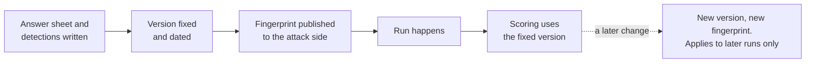

# 4. Fair and repeatable

[Back to the overview](../README.md)

The testbed is judged on one thing: are its results fair and repeatable? These rules are already in force, before the first run.

## Why rules are needed

Two things can quietly spoil a result like this:

- **The attacker side learns the answers.** If the attacker, or the person setting it up, knows which detections exist, the attack can be shaped to avoid them or to trigger them.
- **The defender side adjusts after the fact.** If detections are changed after seeing what the attacker did, the "caught" numbers look better than they are.

## Rule 1: the two sides are kept apart

- The attack side never sees the answer sheet, the detections, how the logs are collected, or the scores.
- Scores never go back to the attack side.
- When information must pass between the sides, only what the attacker is allowed to know is passed.

## Rule 2: the answers are fixed before any run

- The answer sheet and the detections get a version and a date before any run is read.
- A fingerprint of that version is shared before the run. A fingerprint is a short code that proves a file existed in that exact form, without showing what is in it.
- Each run records which fingerprint was in force.
- If a detection is changed after a run, it becomes a new version. It applies only to later runs. Earlier runs stay judged by the old version.

## Rule 3: every run has one ID

Each run gets one ID. The same ID is on the command log, the run record and the score. The ID does not say which mode the attacker ran in, so the people scoring it are not influenced by that.

## Rule 4: a run counts only if it passes every check

| Check | Why |
| --- | --- |
| The range was reset to its clean start before the run | Every run starts from the same place |
| The clocks were compared and were close enough | Actions are matched to alerts by time |
| The command log is complete and unchanged | The log is chained, so a removed or edited line shows |
| No network traffic exists without a matching logged command | Nothing happened outside the record |
| The list of what the attack covers was fixed before the run | The attack was not adjusted afterwards |
| The answer sheet and detection versions were fixed before the run | The scoring was not adjusted afterwards |

A run that fails a check is kept and marked invalid. It is never deleted.

## Rule 5: at least three runs for each result

An AI agent does not behave the same way twice. One run can succeed by luck and the next can fail. So every result comes from at least three valid runs of the same setup, and is reported as a count, for example "caught in 2 of 3 runs".

## Rule 6: rules change in the open

If a rule needs to change, the change is written down with a date and the run it starts from. Runs made before the change keep the rules they ran under.

## Still open

These decisions are not made yet:

- Whether the AI attacker is told which techniques to use, or only given a goal.
- Whether guardrail tests are run with the attacker knowing how the guardrail works, or not.

Next: [Safety](5-safety.md)
