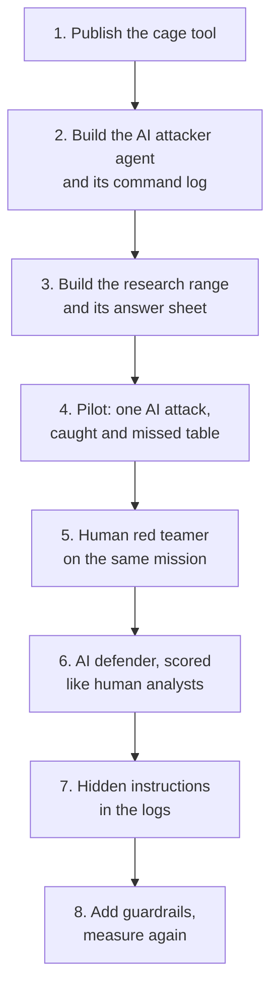

# 6. Roadmap

[Back to the overview](../README.md)

The steps are in order. Each one depends on the one before. The pilot (step 4) is planned for early 2027. Later steps have no dates yet.

| Step | What it gives | Question |
| --- | --- | --- |
| 1. Publish the cage tool | Others can check how the AI attacker is contained | |
| 2. AI attacker agent and command log | A record of every action, ready for scoring | 1, 4 |
| 3. Research range and answer sheet | The place to measure, and the key to score against | 1 |
| 4. Pilot | The first real numbers: what was caught and what was missed, for one attack path | 1 |
| 5. Human red teamer on the same mission | The human number to compare with | 1 |
| 6. AI defender | An AI analyst scored on the same scale as people | 2 |
| 7. Hidden instructions in the logs | How often the AI defender can be fooled | 3 |
| 8. Guardrails, then measure again | Whether existing guardrails change the numbers | 3, 4 |

## What the pilot will and will not show

The pilot is small on purpose: one model, one range, one attack path, at least three runs. It will show that the method works and give a first caught and missed table. It will not support general claims about AI attackers.

## What would make it stronger

- More than three runs per setup, because AI agents vary from run to run.
- More than one model, so results are not about a single system.
- More than one attack path.
- Access to guardrails and to people who build them.

## Open decisions

See [Fair and repeatable](4-fair-and-repeatable.md#still-open).

[Back to the overview](../README.md)
